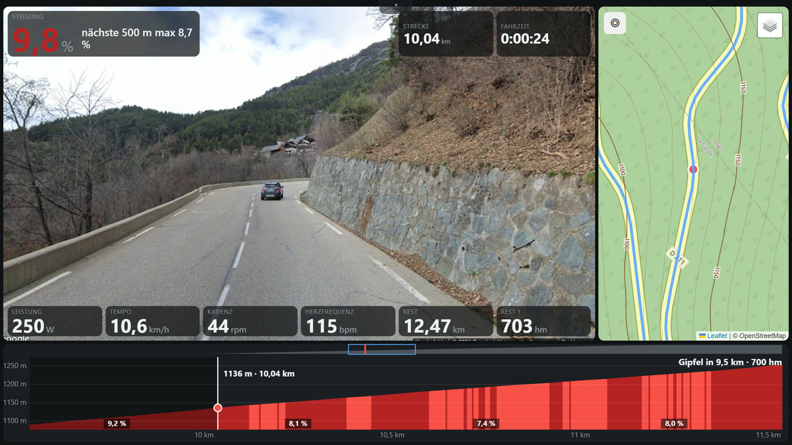
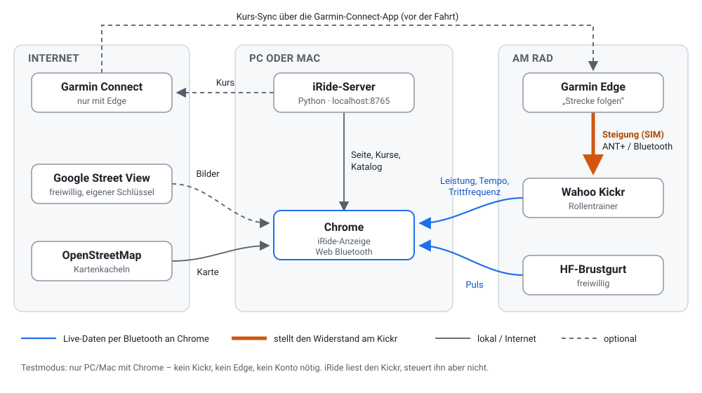
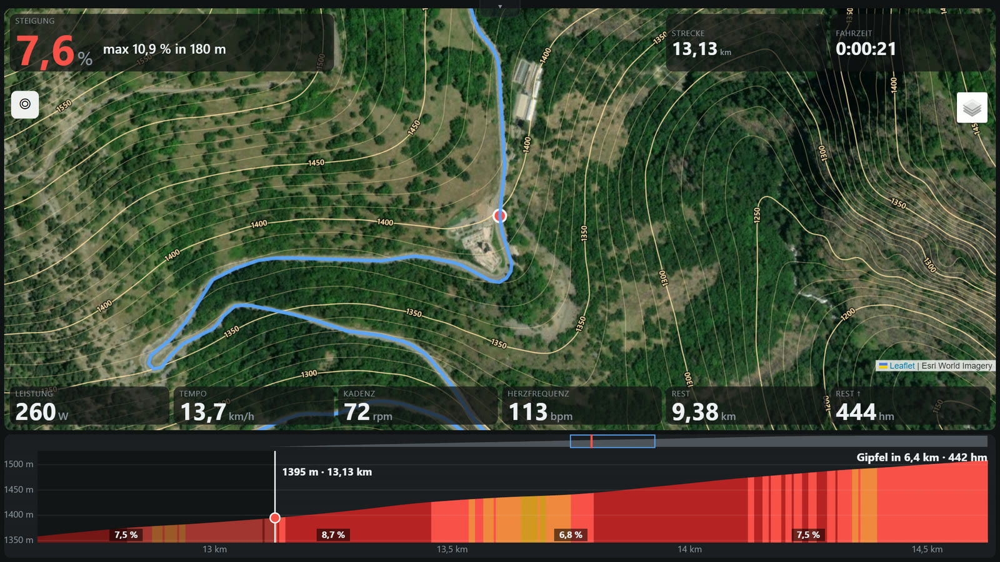
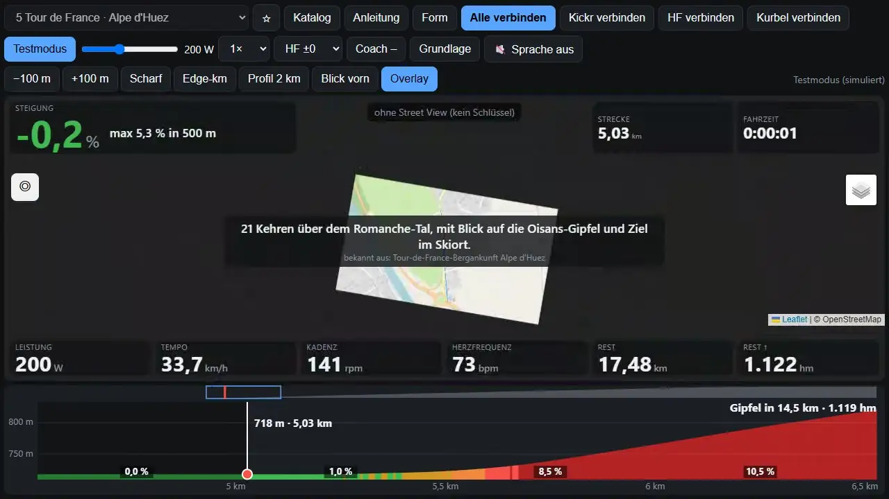
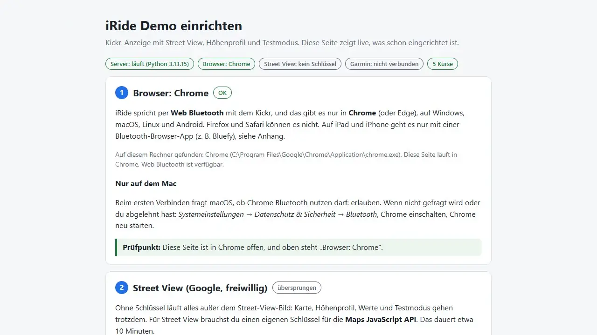
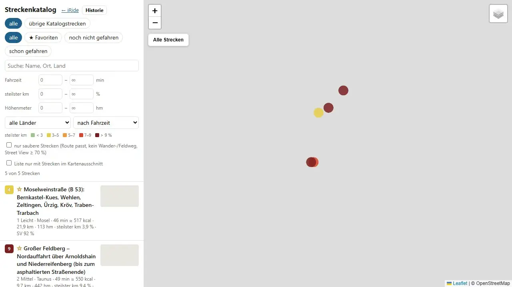
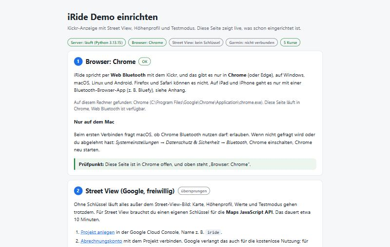
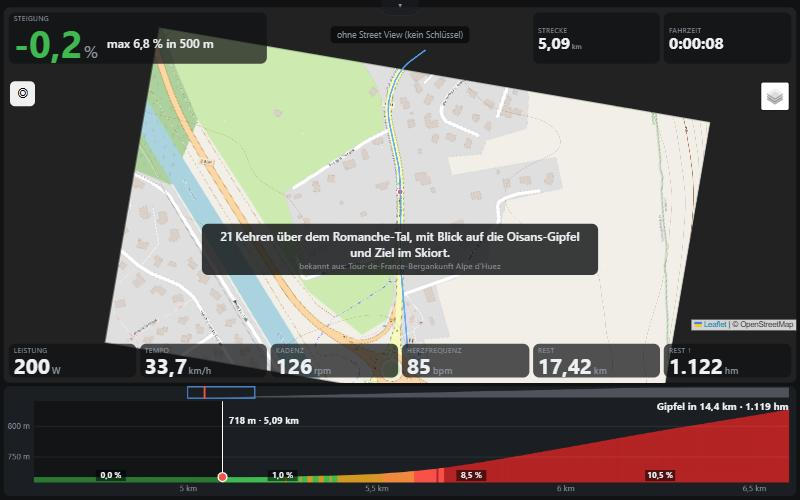
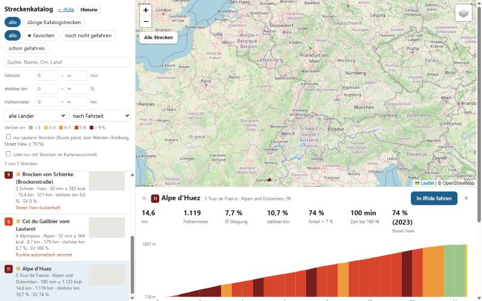

# iRide Demo



<sub>Alpe d'Huez, km 10 unterhalb von Huez, 9,8 % Steigung, mit eigenem Google-Schlüssel. Street-View-Bild © Google,
Karte © OpenStreetMap-Mitwirkende.</sub>

Kickr-Trainingsanzeige im Browser: Street View, Karte, Höhenprofil und Live-Werte vom Wahoo Kickr über Web Bluetooth.
Mit Testmodus ohne Kickr und fünf Demo-Kursen von leicht bis Tour de France. Der Server läuft lokal auf deinem
Rechner, alles liegt im Repo-Ordner in einer eigenen Python-Umgebung (`.venv`).

iRide ist die Anzeige: Es liest Leistung, Tempo und Trittfrequenz vom Kickr, stellt aber den Widerstand nicht ein.
Die Steigung am Kickr kommt von einem Garmin Edge, der denselben Kurs fährt; den Kurs schickt iRide über Garmin
Connect an den Edge. Für den Testmodus brauchst du weder Kickr noch Edge.

## So hängt alles zusammen



| Gerät / Dienst | Wofür | Nötig? |
|---|---|---|
| PC oder Mac mit Python 3.12+ und Chrome | Server und Anzeige | immer |
| Wahoo Kickr | Leistung, Tempo, Trittfrequenz für iRide | für echte Fahrten (Testmodus: nein) |
| Garmin Edge | fährt den Kurs mit und stellt die Steigung am Kickr ein | für spürbare Steigung |
| Garmin-Connect-Konto | bringt den Kurs aus dem Katalog auf den Edge | nur mit Edge |
| HF-Brustgurt (Bluetooth) | Puls in iRide; darf parallel per ANT+ am Edge hängen | freiwillig |
| Google-Schlüssel (Maps JavaScript API) | Street View statt Karte | freiwillig |
| Tablet im WLAN | Anzeige auf dem Tablet über HTTPS (`--lan`); iPad nur mit Bluefy, siehe unten | freiwillig |

**Ablauf einer Fahrt mit Kickr und Edge**

1. Im Katalog die Strecke wählen, „In iRide fahren“: Der Kurs landet in iRide und über Garmin Connect auf dem Edge
   (Edge einmal synchronisieren).
2. Am Edge „Strecke folgen“ mit demselben Kurs, Kickr am Edge als Fahrradtrainer gekoppelt.
3. In iRide „Kickr verbinden“, optional „HF verbinden“. Andere Bluetooth-Apps (Wahoo, Zwift) vorher trennen.
4. Füße still, in iRide „Scharf“ tippen, am Edge Start drücken, lostreten: Beide zählen ab dem ersten Tritt.
5. Weicht die Distanz ab: „Edge-km“ tippen und den Wert vom Edge eingeben. Maßgeblich ist der Edge.

## So sieht es aus

**Ohne Google-Schlüssel: Satellit mit Höhenlinien**, Alpe d'Huez bei km 13, 7,6 % in den Kehren:



<sub>Satellitenbild © Esri, Höhenlinien aus freien Höhendaten.</sub>

**Testmodus auf Alpe d'Huez** (Zeitraffer 20×, Leistung auf 280 W hochgedreht):



<details>
<summary><b>Einrichtung</b>: Anleitung mit Live-Status, ein Klick startet den ersten Kurs</summary>


</details>

<details>
<summary><b>Katalog</b>: Strecken mit Karte und Steigungsprofil, „In iRide fahren“</summary>


</details>

Die Videos in voller Auflösung: [Testmodus](docs/videos/testmodus.mp4) · [Einrichtung](docs/videos/einrichtung.mp4) ·
[Katalog](docs/videos/katalog.mp4). Die Videos sind ohne Google-Schlüssel aufgenommen, deshalb mit Karte statt Street View.

## Schnellstart

> **Getestet nur unter Windows 11.** macOS und Linux sind nicht getestet: Die Skripte dafür sind vorbereitet,
> aber auf keinem Mac und keinem Linux-Rechner ausprobiert.

**Voraussetzungen:** Python 3.12 oder neuer ([python.org](https://www.python.org/downloads/)) und Google Chrome.

1. **Holen:**
   ```
   git clone https://github.com/thomasrinder-debug/iride-demo.git
   ```
   oder als ZIP herunterladen und entpacken.
2. **Einrichten:**
   - Windows: `einrichten.cmd` doppelklicken.
   - macOS (nicht getestet): `einrichten.command` doppelklicken (beim ersten Mal Rechtsklick → Öffnen).
   - Linux (nicht getestet): `sh einrichten.sh`.

   Das Skript legt `.venv` an, installiert zwei Pakete, prüft Chrome, startet den Server und öffnet die
   **Anleitung in Chrome**. Dort geht es weiter: Street View (Google-Schlüssel) und Garmin, beides freiwillig, mit
   Live-Status.

   *Prüfpunkt:* Im Browser steht „iRide Demo einrichten“, oben „Server: läuft“ und „5 Kurse“.

   
3. **Fahren:** In der Anleitung unter „Los geht's“ einen Kurs anklicken. Der Testmodus fährt ohne Kickr.

   *Prüfpunkt:* Die Distanz zählt hoch, der Punkt auf dem Höhenprofil wandert.

   

Der Knopf „Katalog“ zeigt die fünf Strecken mit Karte und Steigungsprofil:



Später reicht `start.cmd` (Windows) bzw. `start.command` (macOS) bzw. `sh start.sh`.
Die Anleitung bleibt erreichbar unter <http://localhost:8765/anleitung/> und über den Knopf „Anleitung“.

## Browser: Chrome am Rechner, Bluefy auf dem iPad

iRide spricht per **Web Bluetooth** mit Kickr und Brustgurt. Das können nur Browser mit Chromium-Engine.

| Gerät | Browser | Kickr verbinden? | Adresse |
|---|---|---|---|
| Windows, Mac, Linux | **Chrome** oder Edge | ja | `http://localhost:8765/`, kein Zertifikat nötig |
| Android-Tablet | **Chrome** | ja | `https://<IP>:8443/` mit `--lan`, CA installieren |
| iPad, iPhone | Chrome, Safari, Firefox, Edge | **nein** | – |
| iPad, iPhone | **Bluefy** (App Store) | ja | `https://<IP>:8443/` mit `--lan`, CA installieren und vertrauen |

**Warum nicht Chrome auf dem iPad?** Chrome auf iPad und iPhone läuft mit Apples Safari-Engine (WebKit), wie alle
gängigen iOS-Browser, und die kennt kein Web Bluetooth. Chrome auf dem iPad zeigt iRide an und kann den Testmodus fahren, aber der Knopf
„Kickr verbinden“ tut nichts. Bluefy ist ein Browser, der Web Bluetooth auf iOS nachrüstet.

**iPad mit Bluefy, Schritt für Schritt:**

1. Am Rechner `start.cmd --lan` bzw. `sh start.sh --lan`. Das Terminal zeigt die Adressen mit der IP des Rechners.
2. Auf dem iPad in **Safari** `http://<IP>:8765/ca.crt` öffnen, Profil laden; dann *Einstellungen → Allgemein →
   VPN und Geräteverwaltung* installieren und *Einstellungen → Allgemein → Info → Zertifikatsvertrauenseinstellungen*
   für „iRide Demo lokale CA“ einschalten.
3. In **Bluefy** `https://<IP>:8443/` öffnen, „Kickr verbinden“, Kickr in der Liste wählen.
4. *Einstellungen → Anzeige & Helligkeit → Automatische Sperre: Nie*, sonst geht das iPad während der Fahrt aus.

Für den Google-Schlüssel kommt mit `--lan` die Adresse `https://<IP>:8443/*` zu den erlaubten Websites hinzu.
Die Windows-Firewall fragt beim ersten `--lan`-Start, ob Python im privaten Netz erreichbar sein darf: zulassen.

## Was wo liegt

| Pfad | Inhalt |
|---|---|
| `einrichten.py` | geführte Einrichtung (venv, Browser-Check, Server, Google, Garmin) |
| `iride_server.py` | lokaler Server (nur Standardbibliothek; `cryptography` nur für `--lan`) |
| `web/index.html` | die Anzeige |
| `web/anleitung/` | Anleitung mit Live-Status |
| `kurse/` | die fünf Kurse, die iRide in der Liste zeigt |
| `katalog/` | Demo-Streckenkatalog (Karte, Profil, GPX zum Herunterladen) |
| `garmin_kurs.py` | Kurs über Garmin Connect an den Edge schicken |
| `browser.py` | Chrome/Edge finden und öffnen |
| `lokal.example.py` | Vorlage für `lokal.py` (Schlüssel, Einstellungen) |

Nicht im Git (`.gitignore`), nur auf deinem Rechner: `.venv/`, `lokal.py` (Google-Schlüssel), `daten/` (Garmin-Tokens),
`nutzer/` (Favoriten, Fahrten), `logs/`, `_zertifikat/`. Außerhalb des Repo-Ordners legt das Demo nichts an.

## Optionen

```
start.cmd --http-port 18765   # anderer Port
start.cmd --lan               # zusätzlich HTTPS im WLAN fürs Tablet (Anleitung, Anhang)
start.cmd --test              # nichts zu Garmin schicken
einrichten.cmd --garmin       # nur Garmin neu anmelden
```

Unter macOS und Linux dasselbe mit `sh start.sh …` bzw. `sh einrichten.sh …`.

## Stand der Tests

- **Windows 11:** Einrichtung aus frischem Klon, Server, Anleitung, Testmodus und Katalog getestet.
  Noch offen im Demo: Street View mit echtem Schlüssel, Garmin-Anmeldung, echter Kickr, `--lan`.
- **macOS und Linux: nicht getestet.** Die Skripte sind POSIX-sh und mit shellcheck geprüft, die Pfade
  plattformneutral, gelaufen sind sie aber auf keinem Mac und keinem Linux-Rechner. Offene Punkte stehen in der
  Anleitung unter „Prüfliste macOS und Linux“.

## Daten und Lizenzen

- Kurse: Straßenverlauf aus © OpenStreetMap-Mitwirkende ([ODbL](https://opendatacommons.org/licenses/odbl/)),
  geroutet mit BRouter, Höhen aus SRTM (geglättet).
- Karte: OpenStreetMap-Kacheln, Satellit von Esri; Street View über die Google Maps JavaScript API mit eigenem Schlüssel.
- Leaflet und leaflet-rotate: siehe `web/vendor/LICENSE-*`.
- Code: MIT-Lizenz, siehe `LICENSE`. Die Kursdaten stehen unter der ODbL (siehe oben).
